+++
date = '2026-09-27T17:38:53+08:00'
draft = false
math = true
title = '明十三陵旅游杂谈'
+++
## 怎么突然这么闲开始写东西了

感觉ai时代再不写点东西好像要彻底变成只会扣 QQ 信息的 AI了。 我其实很早就想要搞个skill 或者 ai 之类的东西让他把说话的风格换成我的风格， ~~这样有时候就可以让ai假装我帮我做事了， 尤其是写实验报告的时候非常有用可惜本科课程已经毕业了。~~ 于是我开始找找我自己以前写的文字， 发现要么活在试卷上， 要么电子档都被我用 ai 过了一遍润色， 好像唯一稍微长点的还留存的手写稿就是我发给老师们的读研申请电子邮件实在有点让人绷不住。 看起来是时候该复兴一下古早时期的更新博客习惯了！ 刚好感觉上班上乏了， 不如同步搭配一点旅游计划，刚好有点写东西的素材。虽然但是也没有什么文笔， 写到哪里算哪里，努力让自己像个人类吧！

## 怎么去这么远的明十三陵了
说是明十三陵旅游， 其实依旧是惯例去了神道、定陵、长陵。
为什么会突然想去明十三陵呢， 主要原因还是因为最近玩《饿殍：明末千里行》导致的。

虽然故事特别短， 但是我好像很喜欢这种国风画风也喜欢这种故事情节， 可能主要是画风比较喜欢，~~虽然女主的cv有点容易出戏。~~ 但是聪明可爱的人设还是确实很圈粉的， 放点图展示一下。

{width=160 align=center}

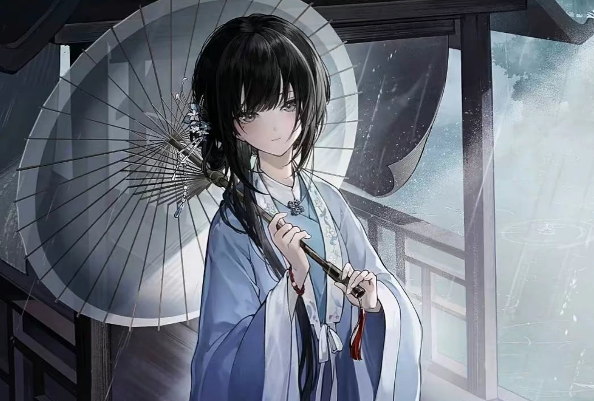
{width=280 align=center}

{width=160 align=center}

总之就是感觉主角很好看， 故事很上头， 然后又急头巴脸的看了续作《哀鸿：城破十日记》。虽然说这个东西设定感觉神人完了， 主角也神人完了， 但是好像还是玩进去了， 感觉作者剧情创作有点过于变态，但是好像情感线又有不少像人的部分， 总之看完以后还是十分难受， 剧情看着难受， 看着作者这么写人物也难受。 但是秉承着学计算机的都是 M 的这么一个设定还是在不停的刷二创。但是二创一下就刷完了， 于是开始看扬州十日记和一些明末材料。

有一说一， 我感觉我也是个神人， 感觉不知道为什么开始看《明朝那些事儿了》。这书感觉好像从小就听说挺有名但是好像一直没有看。而且虽然好像从小是挺喜欢看历史书的人， 但是感觉好像脑子里关于明朝历史感觉好像空空如也， 于是从看游戏二创变成了看明朝小视频和明朝那些事。

但是啊， 正逢中秋佳节， 这看小说小视频工作日下班了也可以看， 不能放假就看点这吧？ 放假不出去玩那不是白放了吗？刚好让我看看北京有什么明代景点， 诶哟， 明十三陵， 那就这个了， 今天就去这个吧。

## 正片

**严肃提醒， 北京旅游年票不包含定陵**

**非严肃提醒， 可以不带身份证**

问就是主播没带身份证还买了年票。

### 神路

下地铁的时候听到了两个小姐姐打算直接打车去定陵。我思考了一下， 这不对啊， 我看小红书都说先到神路再去各个陵墓， 这怎么没人去这个神路呢？ 等我到了神路， 我就明白这是怎么回事了。

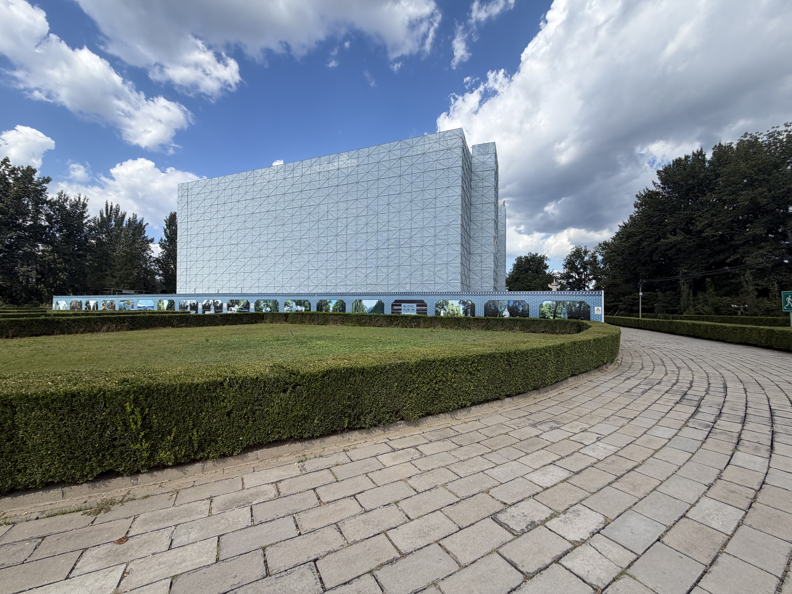

进景点第一眼看到这么大的施工建筑物谁能绷住.jpg
不过倒是无所谓， 其实感觉也没指望一条路会有多么华贵的建筑。

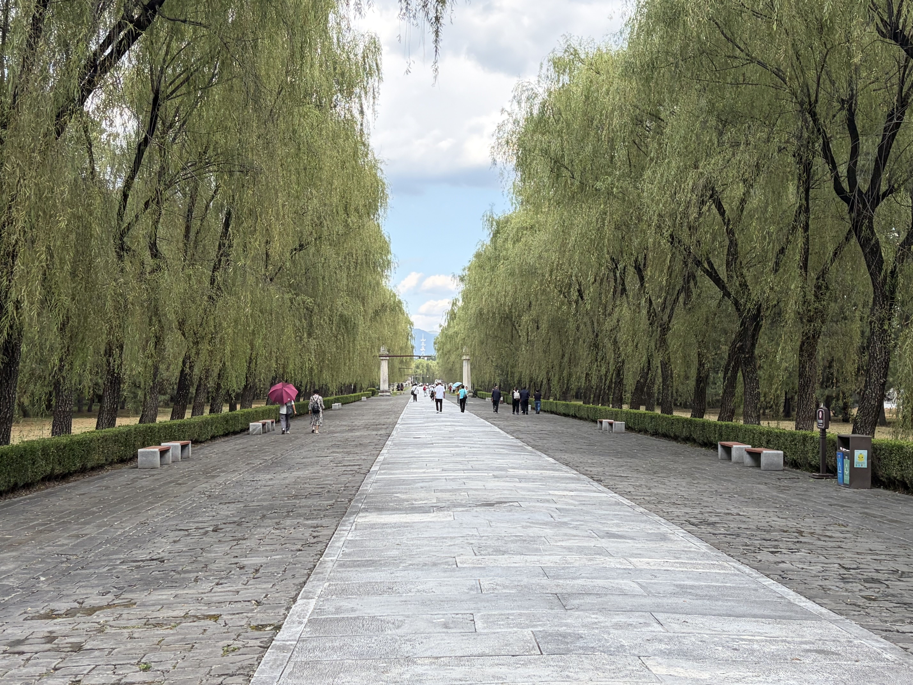

确实就是一条 1.5km 的路， 去每个帝王的陵墓都要经过这些地方。路的两旁是很多很多石像， 有一些大象、骆驼之类的东西。看起来除了一个神兽以外， 雕刻的都是一些存在的东西， 比如各个地方的动物， 或者是文武百官， 感觉作为礼仪场景还是很 make sense的。

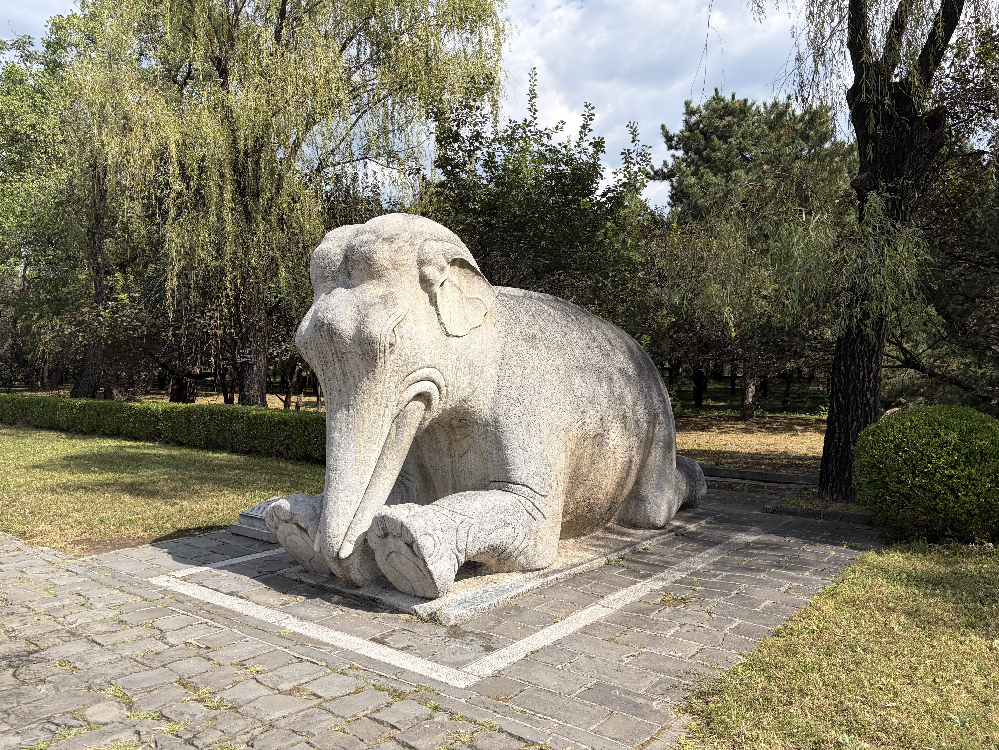
{width=800 align=center}
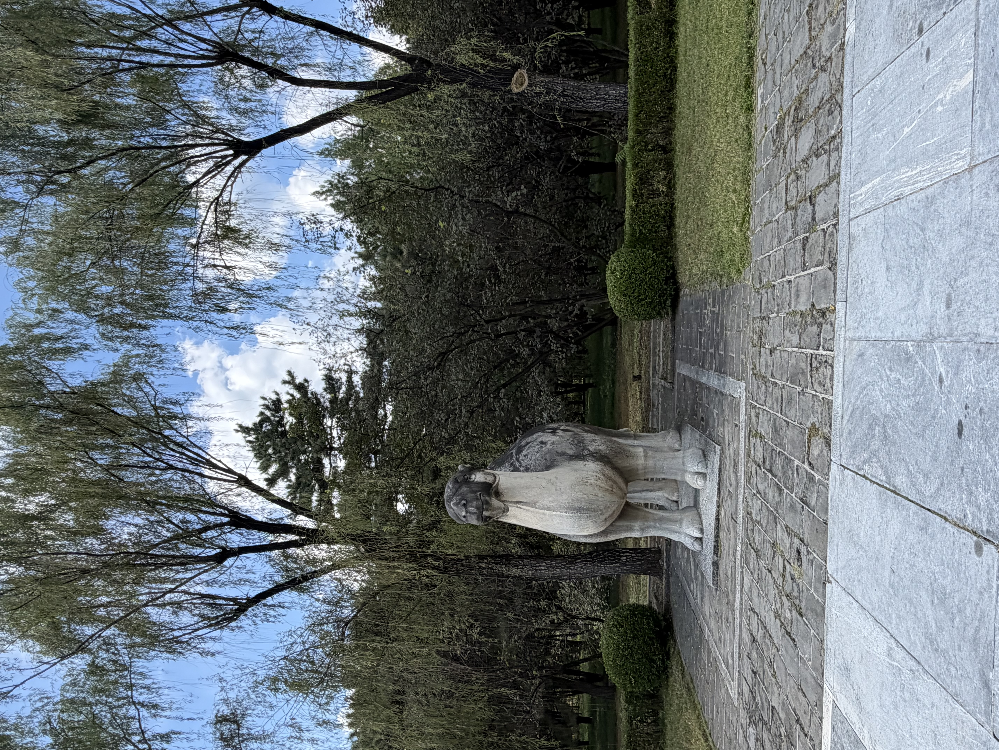
{width=800 align=center}
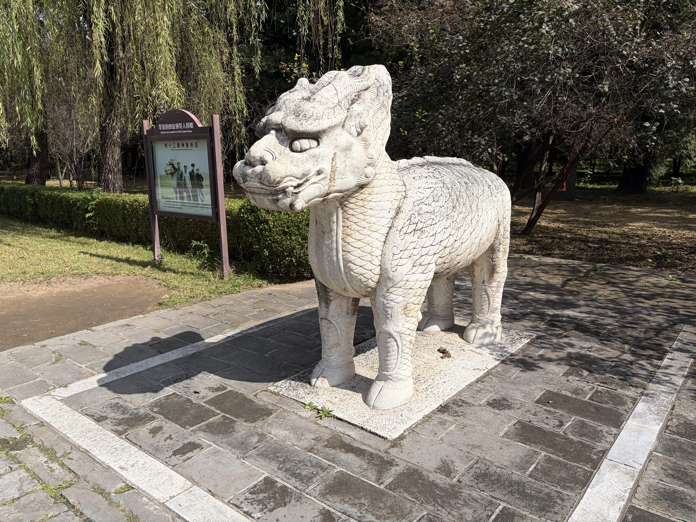
{width=800 align=center}

### 定陵
这个则是重头戏了，万历皇帝的陵墓。 我在去之前并没有看每个陵墓对应哪位皇帝， 去的路上还在听万历十五年的书， 到了以后发现这个唯一一个被挖开陵墓的倒霉皇帝就是万历， 倒是也巧合。

突然感觉写博客好像确实还是写前面的闲话有意思， 我果然还是只是想写些闲话， 写游记还是真没意思。

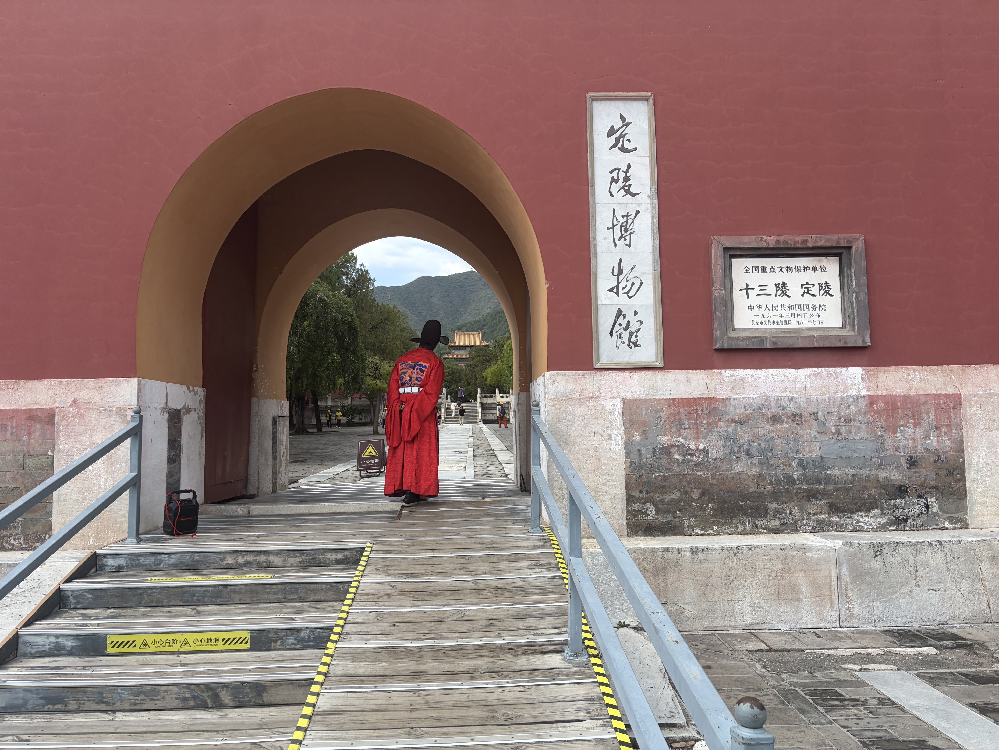

其实门口就可以远远看到一座很高的大殿了。 那座远远的楼似乎被称作明楼， 牌子上的英文翻译看起来是 Soul Tower， 那含义也就可见一斑了。不得不说感觉 Soul Tower 听起来有点像是挺阴间的招魂塔， 咱这的建筑倒是看起来还是挺阳间的。

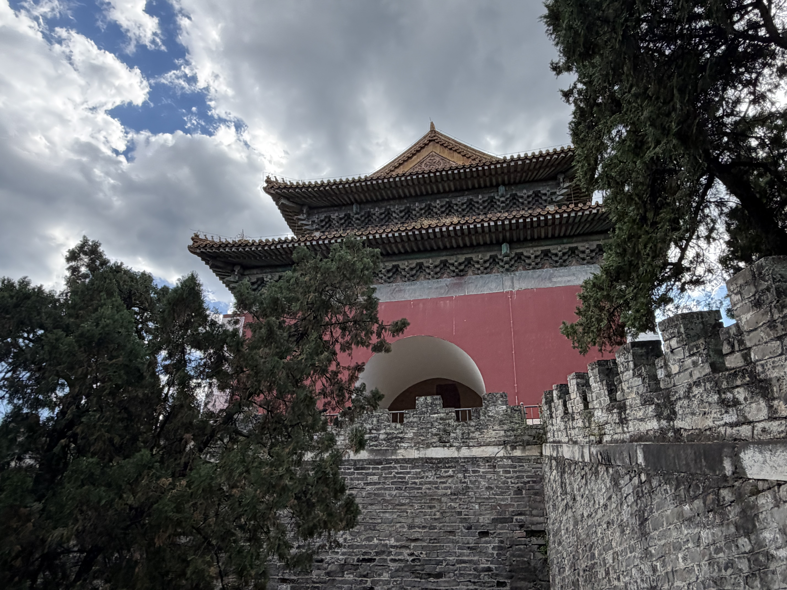

这楼的后下方就是地宫， 接下来就是下很多很多层楼梯， 下到阴森的地宫。地宫据说有九层楼高， 总之下地宫的时候感觉下了很久很久楼梯。 这玩意怎么建出来的真是匪夷所思。地宫里感觉太阴间了， 不敢拍照， 手机也没有信号， 四处感受一下， 只记得盯了一段时间皇帝皇后们的霉点斑斑的棺材就匆匆跑路了。有一说一还是很享受看着棺的时候那种历史交错的感觉的， 但是感觉又不想太交错了， 毕竟还是不想看眼前万历复活的。 记得当年去看辛追夫人的时候看完咳嗽了一两个月也没好， 这次还是溜快点好。

我曾听说明十三陵上又巨大的土堆， 但是我好像一直没发现在哪里。溜出来地宫在明楼上往后看， 才发现原来我登的山就是一个巨大的土堆。

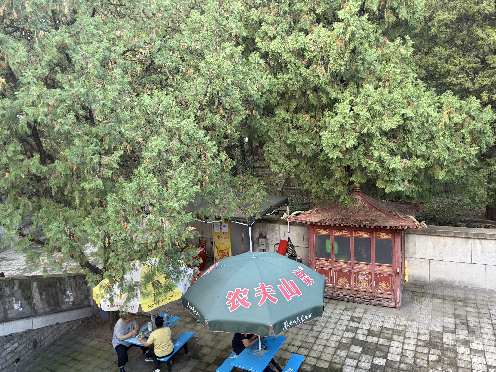

红色房子后的围栏， 其实是用来围土的， 这下结构就看懂了。 原来是我就站在这大土堆上， 大土堆后面还有层层叠叠的这样的土堆围栏。帝王陵墓的工程真是难以想象。

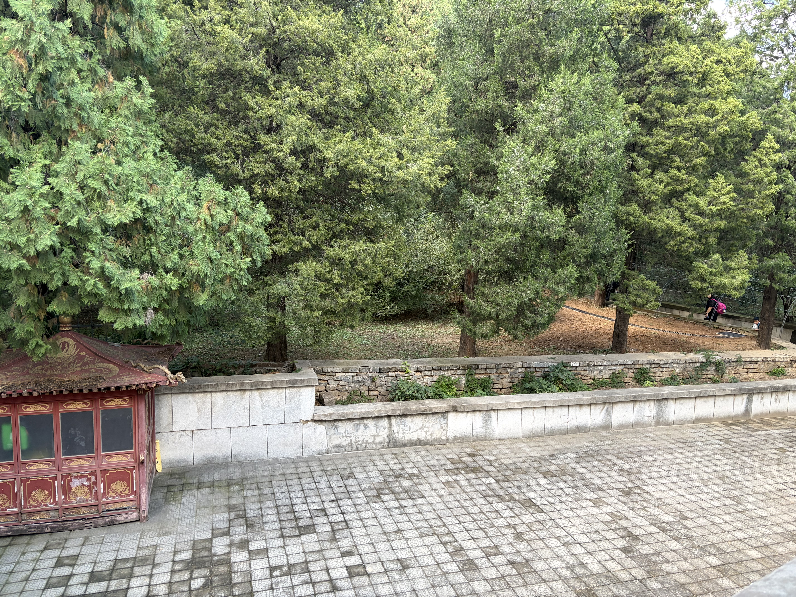

最后看了看楼上景色便跑路了。

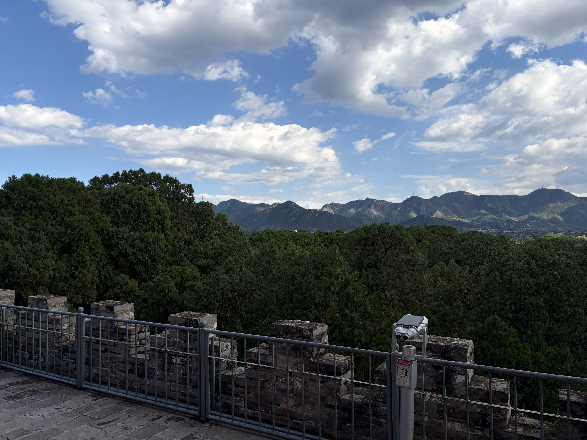

### 长陵

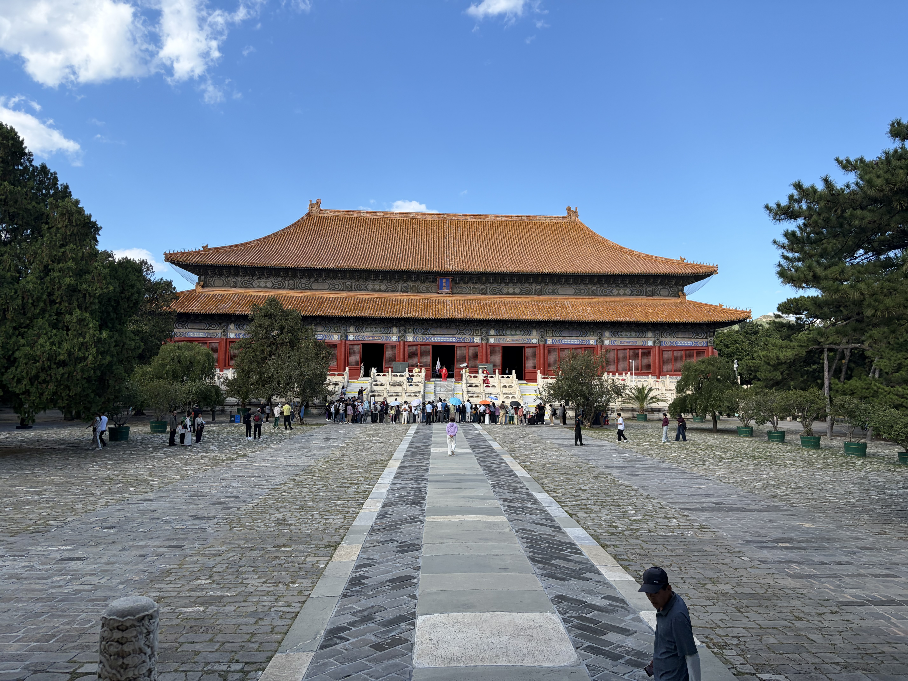

感觉没啥可看的， 其实一张图就说明问题了。 长陵后面好像在施工， 感觉比较遗憾。但是本质上来说我觉得明十三陵其实就是来看定陵， 以及看看帝王陵墓的风水的， 所以倒是感觉也影响不大。 但是总的来说感觉有点遗憾， 感觉好像很多地方又唐宋文化、清文化表演或者整理， 但是生活里好像很少看见明文化整理之类的活动或者景点。 大名鼎鼎的明十三陵， 似乎也没有怎么被开发， 想找找这个朝代的痕迹， 看起来是相当困难。

感觉， 可能该在接下来的日子里留心留心明代的遗迹吧。感觉好像还是一个明文化的白痴， 也没法为明十三陵写些什么东西了， 真是学识匮乏。
